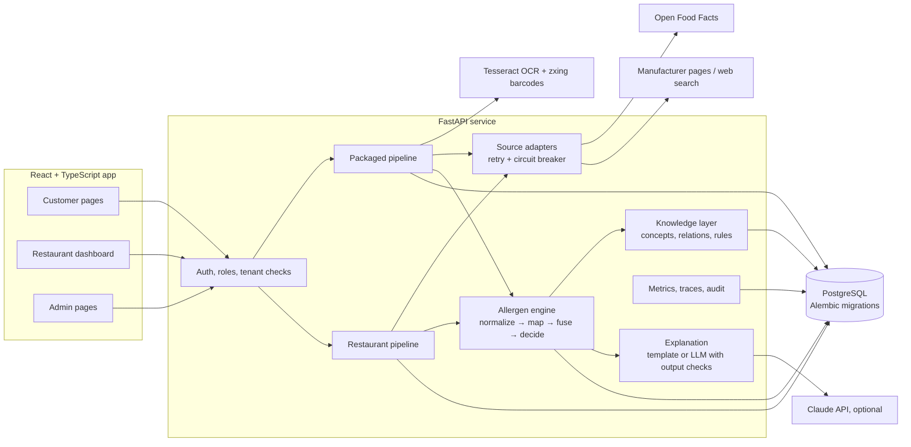
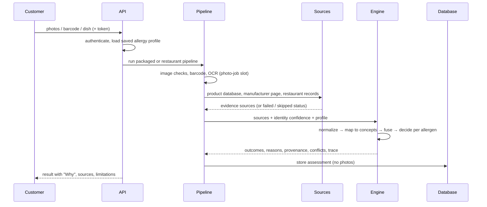
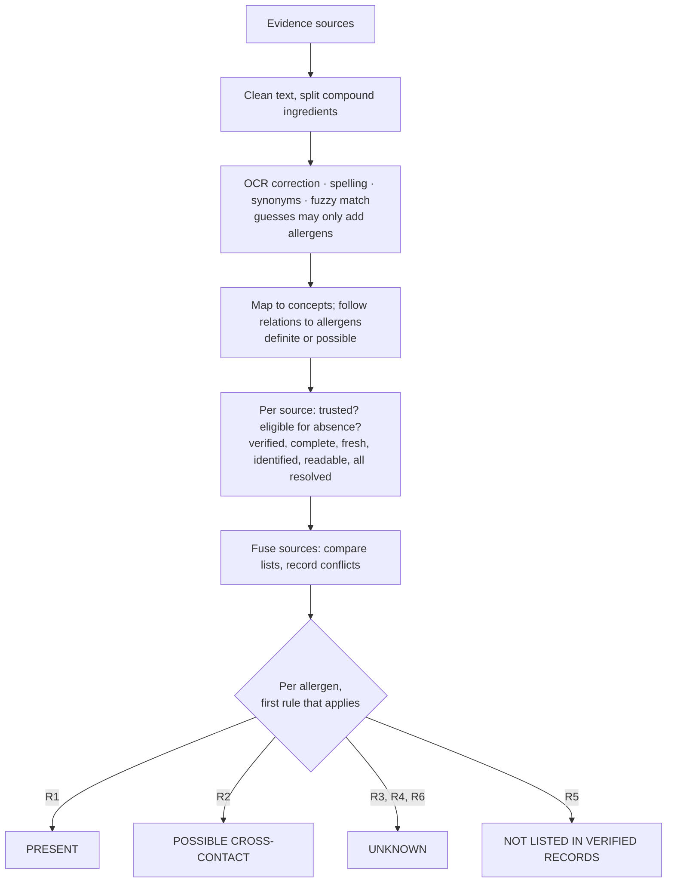
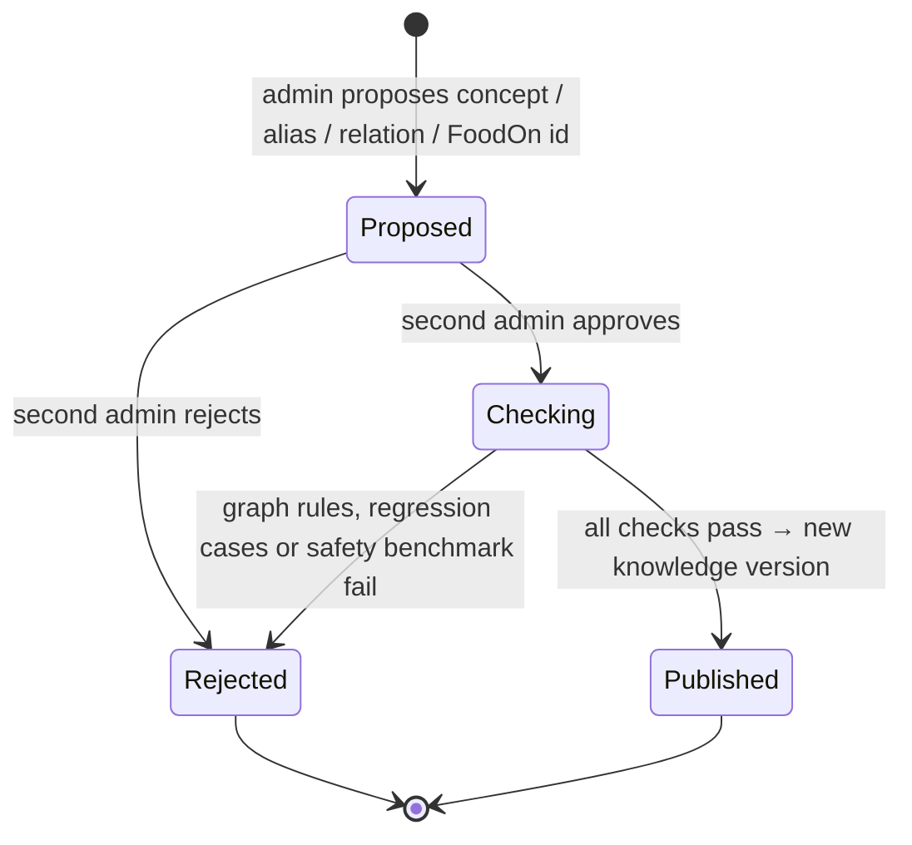
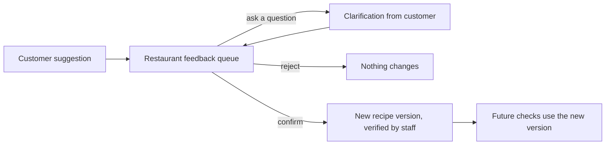
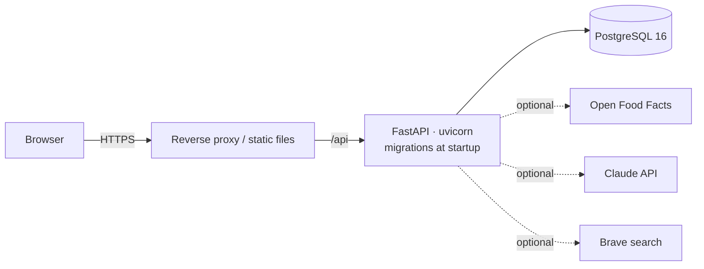

# Architecture

AllergyGuard is one FastAPI service, a PostgreSQL database and a React single-page app. Both customer
pathways (packaged food and restaurant food) feed one deterministic allergen engine; external services
are optional sources that can fail without breaking a check. The diagrams below are Mermaid (they render
on GitHub).

## 1. Components

| Component | Code | Responsibility |
|---|---|---|
| Auth and roles | `app/api/deps.py`, `app/core/security.py` | JWT sign-in; customer / restaurant (owner, manager, staff) / admin; restaurant membership on every dashboard route |
| Packaged pipeline | `app/packaged/` | photo checks, barcode, OCR, product identification, external sources |
| Restaurant pipeline | `app/restaurant/` | dish matching, branch and recipe-version selection, unregistered-restaurant fallback |
| Source adapters | `app/sources/` | one interface for every evidence source; health counters, retries, circuit breaker |
| Allergen engine | `app/engine/` | normalization, concept mapping, evidence fusion, decision rules, provenance, trace |
| Knowledge layer | `app/knowledge/`, `app/seed/` | ingredient concepts and relations, validation rules, versioned four-eyes changes |
| Evaluation | `app/evaluation/` | development benchmark and release gate, held-out runner, baselines, ablations |
| Observability | `app/core/` | request ids, structured events without personal data, metrics, limits |

## 2. One check, end to end

## 3. Inside the engine

## 4. Knowledge changes

## 5. Restaurant feedback

A suggestion is shown to customers only as an unverified candidate until staff confirm it.

## 6. Deployment

`docker-compose.yml` runs the database, API and frontend. CI runs the tests and the safety gate on every
push (`.github/workflows/ci.yml`).
